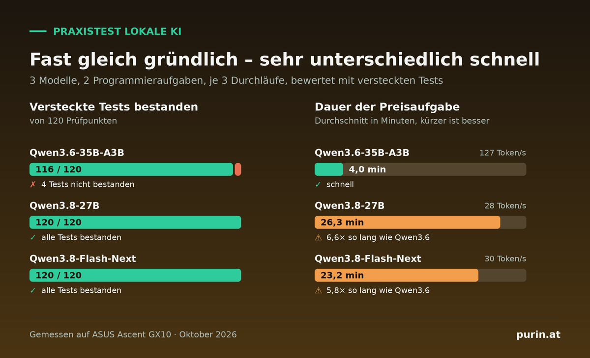

# GX10 Coding-Benchmark (12.10.2026)



> **English summary:** A small, reproducible benchmark that runs local LLMs as a coding agent in OpenCode
> on multi-turn tasks and grades the result with hidden tests the model never sees. Tasks, harness,
> proxy and raw results are all in this repo. Measured on an ASUS Ascent GX10 (NVIDIA GB10, 128 GB).

Die Hintergründe und die Einordnung stehen im Blogbeitrag auf [purin.at](https://www.purin.at/lokale-ki-programmieren-praxistest/).

Wie gut arbeiten lokale Modelle als Coding-Agent in OpenCode? Gemessen auf einer ASUS Ascent GX10
(NVIDIA GB10, 128 GB Unified Memory, Ubuntu 24.04, Treiber 580.178.04).

## Ergebnis

| Modell | Stack | Versteckte Tests | Erzeugen | Einlesen | Ø Preise / Buchungen |
|---|---|---|---|---|---|
| Qwen3.6-35B-A3B NVFP4 (`nvidia/Qwen3.6-35B-A3B-NVFP4`) | vLLM 0.29.0, MTP 3 | 116/120 | 127 tok/s | 5.100–6.300 tok/s | 4,0 / 1,8 min |
| dito + `preserve_thinking: true` | vLLM 0.29.0, MTP 3 | 116/120 | 127 tok/s | gleich | 4,1 / 1,6 min |
| Qwen3.8-27B NVFP4 (`unsloth/Qwen3.8-27B-NVFP4`) | vLLM 0.29.0, MTP 3 | 120/120 | 28 tok/s | 1.260–1.610 tok/s | 26,3 / 8,6 min |
| Qwen3.8-Flash-Next (`unsloth/Qwen3.8-Flash-Next-GGUF`, UD-Q3_K_XL) | llama.cpp f2cc728, ohne MTP | 120/120 | 30 tok/s | 840–890 tok/s | 23,2 / 10,2 min |

Rohdaten: `results.jsonl` (eine Zeile pro Lauf), `speed-*.txt` (Ausgabe von `speed_test.py`).

## Aufbau

- **Harness:** OpenCode 2.0.25, `opencode run --standalone --auto`, Provider `@ai-sdk/openai-compatible`.
  Jede Runde ist ein eigener Aufruf, ab Runde 2 mit `-c` (gleiche Sitzung). Jeder Lauf startet in einem frischen Git-Repo.
- **Proxy (`proxy2.py`):** sitzt zwischen OpenCode und Server, setzt den Modellnamen, ergänzt pro Konfiguration
  `chat_template_kwargs` und protokolliert Token, TTFT und Tool-Aufrufe. Er spiegelt `reasoning` nach `reasoning_content`,
  damit auch llama.cpp die Überlegungen früherer Runden bekommt.
- **Aufgabe `pricing` (3 Runden, 22 Tests):** Warenkorb mit Coupons, Rundung, USt. Runde 2 bringt Mengenrabatt und VIP-Coupon,
  Runde 3 ein deutsches Betragsformat. Die Anforderungen stehen nur im Chat.
- **Aufgabe `bookings` (2 Runden, 18 Tests):** Buchungslogik mit eingebauten Fehlern (`seed/`), Regeln in der README.
  Runde 1: Tests reparieren, Runde 2: Storno, Maximaldauer, Sommer-Mindestaufenthalt.
- **Bewertung:** `hidden_test.py` läuft erst nach der letzten Runde. Das Modell sieht diese Tests nie.
- **Tempo (`speed_test.py`):** Einlesen mit zufälligem Text (kein Cache-Treffer), Erzeugen mit 3× 1.200 Token Code, Thinking aus.
- **Sampling:** Standardwerte aus der `generation_config` des Modells (vLLM). Bei llama.cpp `--temp 1.0 --top-p 0.95 --top-k 20 --min-p 0`.
  OpenCode setzt selbst keine Temperatur.

## Serverstart

vLLM (Qwen3.6, Image `vllm/vllm-openai:v0.29.0`):

```
nvidia/Qwen3.6-35B-A3B-NVFP4 --kv-cache-dtype=fp8 --attention-backend=flashinfer --gpu-memory-utilization=0.37
--max-model-len=262144 --max-num-seqs=4 --max-num-batched-tokens=8192 --enable-chunked-prefill --async-scheduling
--enable-prefix-caching --speculative-config={"method":"mtp","num_speculative_tokens":3,"moe_backend":"triton"}
--load-format=fastsafetensors --reasoning-parser=qwen3 --tool-call-parser=qwen3_xml --enable-auto-tool-choice
```

vLLM (Qwen3.8-27B, gleiches Image):

```
unsloth/Qwen3.8-27B-NVFP4 --kv-cache-dtype fp8 --attention-backend flashinfer --gpu-memory-utilization 0.45
--max-model-len 262144 --max-num-seqs 4 --max-num-batched-tokens 8192 --enable-chunked-prefill --async-scheduling
--enable-prefix-caching --speculative-config {"method":"mtp","num_speculative_tokens":3} --load-format fastsafetensors
--reasoning-parser qwen3 --tool-call-parser qwen3_coder --enable-auto-tool-choice
--default-chat-template-kwargs {"preserve_thinking": true}
```

llama.cpp (Flash-Next, gebaut mit `-DGGML_CUDA=ON -DCMAKE_CUDA_ARCHITECTURES=121`):

```
llama-server -m Qwen3.8-Flash-Next-UD-Q3_K_XL-00001-of-00003.gguf -c 131072 -ngl all --parallel 1 --load-mode none
--jinja -fa on --temp 1.0 --top-p 0.95 --top-k 20 --min-p 0 --reasoning-format deepseek
--chat-template-kwargs {"preserve_thinking": true}
```

Jedes Modell lief allein auf der Box.

## Nachmachen

```
python3 run_bench.py --name mein-test --upstream <host>:<port> --model <served-model-name> \
  --inject '{"chat_template_kwargs": {"preserve_thinking": true}}' --runs 3
python3 speed_test.py <host>:<port> <served-model-name>
```

`run_bench.py` erwartet `opencode` im PATH und legt die Arbeitsordner neben dem Skriptordner unter `ocruns/` an.

## Grenzen

- Kleine Stichprobe: 2 eigene Aufgaben, je 3 Läufe. Das zeigt Tendenzen, ersetzt keinen großen Benchmark.
- Flash-Next lief auf llama.cpp mit Q3-Quantisierung, die anderen auf vLLM mit NVFP4. Stack und Quantisierung unterscheiden sich.
- `preserve_thinking` wirkt nur über mehrere Nutzerrunden. Gemessen: Folgefrage bei 150k Token Kontext 3 s statt 55 s,
  weil der Prefix-Cache erhalten bleibt. Die Trefferquote ändert sich in diesem Test nicht.

## Lizenz

MIT, siehe `LICENSE`. Eigene Läufe, andere Modelle und zusätzliche Aufgaben gern als Issue oder Pull Request.
